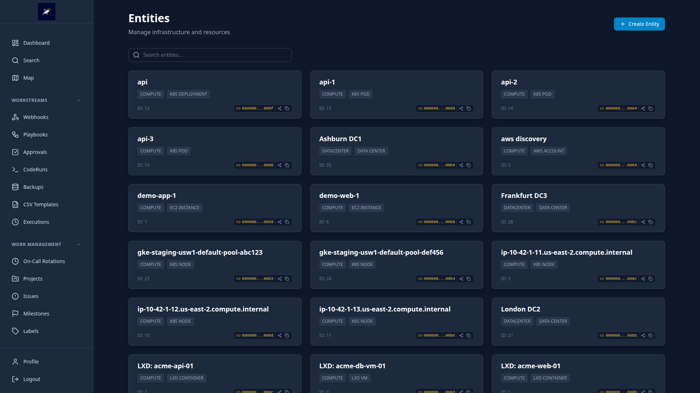
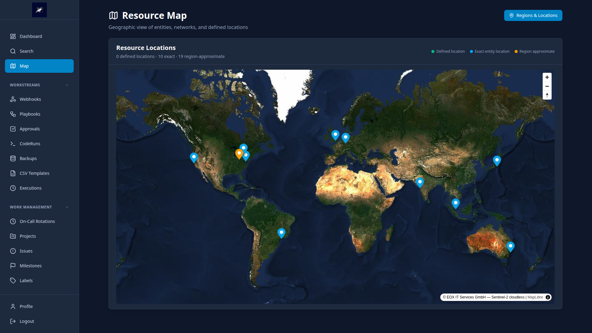
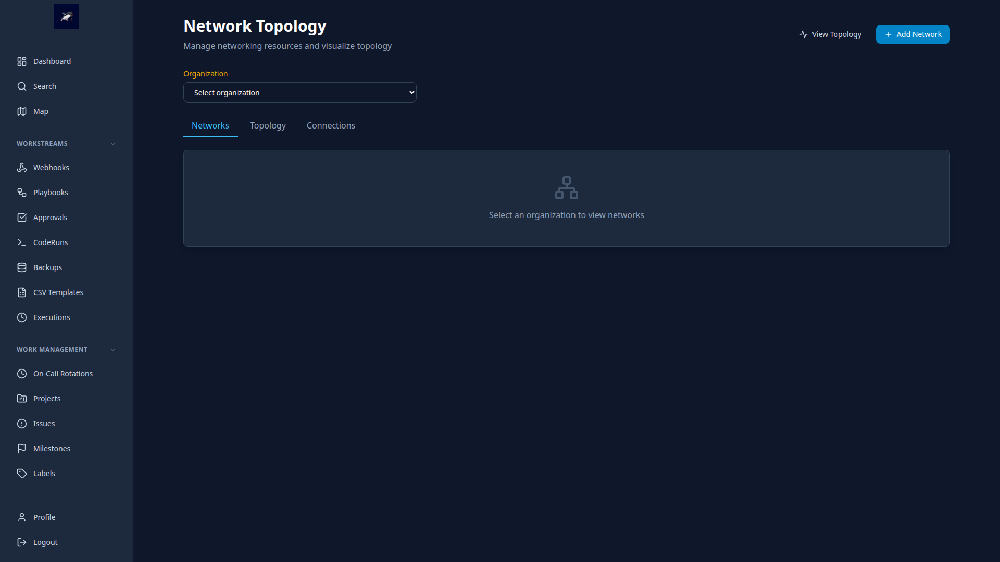
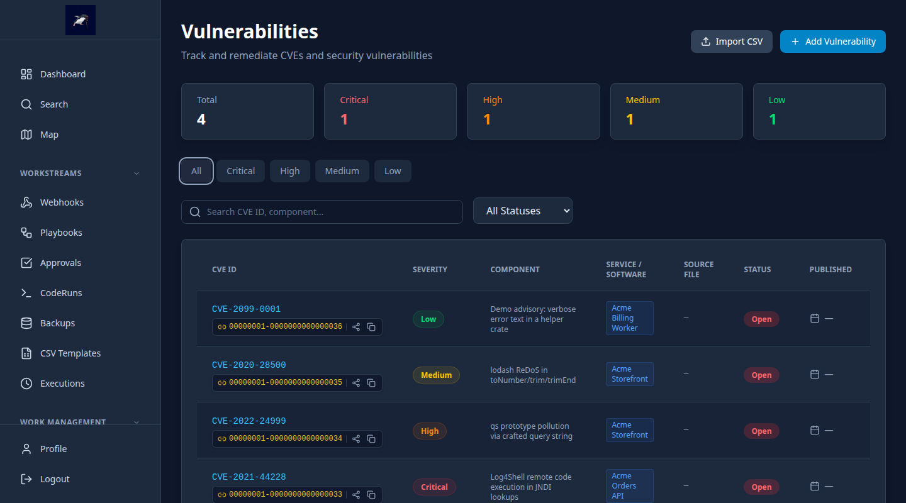

<p align="center">
  
</p>

<h1 align="center">Elder</h1>

<p align="center">
  <strong>Unified IT Asset Management, Identity Governance, Security &amp; Automation Platform</strong>
</p>

<p align="center">
  <a href="https://github.com/penguintechinc/elder/actions/workflows/ci.yml"></a>
  <a href="https://github.com/penguintechinc/elder/releases"></a>
  <a href="https://www.python.org/downloads/"></a>
  <a href="https://www.rust-lang.org/"></a>
  <a href="LICENSE.md"></a>
</p>

<p align="center">
  <a href="https://elder.penguintech.io">Website</a> •
  <a href="https://docs.penguintech.io/elder">Documentation</a> •
  <a href="https://github.com/penguintechinc/elder/discussions">Discussions</a> •
  <a href="https://status.penguintech.io">Status</a>
</p>

---

**Elder** brings your entire internal IT estate—infrastructure, identities, vulnerabilities, workstreams, and documentation—into one graph-backed platform. Built as a modular monolith across the **WIRED** model (*Workstreams, Issues, Relationships, Entities, Documents*), it replaces scattered spreadsheets, CMDBs, and brittle scripts with a single Kubernetes-native control plane.

## Why Elder

| Capability | What You Get |
| :--- | :--- |
| **Asset & Infrastructure Inventory** | Unified CMDB across cloud, Kubernetes, VMs, and endpoints with auto-discovery, interactive Topology Maps, React-Flow Diagrams, and full IPAM. |
| **Identity & Access Governance** | Consolidated identity directory with SAML 2.0 / OIDC SSO, SCIM 2.0 provisioning, periodic Access Reviews, and Secrets, API Keys & Certificate tracking. |
| **Security & Compliance** | Continuous SBOM and CVE scanning via remote-capable `svc-scanner` fleets, vulnerability tracking, compliance metadata, and immutable Audit Logs. |
| **Workstreams & Automation** | Event- and schedule-driven Visual Playbooks with Human Approvals, sandboxed serverless CodeRuns via remote `svc-runworker`, HMAC Webhooks, and S3 + Valkey CSV bulk imports. |
| **Work Management** | Projects, Issues, internal support tickets, Milestones, and On-Call Rotations tied directly to the assets and services they affect. |
| **Built for Everywhere** | Modern React WebUI, hosted **MCP server** (`hub-mcp`) for AI agents, **Python & Rust SDKs**, and a standalone **Rust CLI** (`elder`). |

> Toggle any of Elder's 17 modules per-pillar or per-module at deploy time. See [docs/MODULES.md](docs/MODULES.md) for the WIRED architecture and module flags.

## Screenshots

<table>
  <tr>
    <td width="33%" align="center">
      <a href="docs/screenshots/dashboard.png"></a><br>
      <sub><b>Dashboard</b></sub>
    </td>
    <td width="33%" align="center">
      <a href="docs/screenshots/entities.png"></a><br>
      <sub><b>Entities &amp; CMDB</b></sub>
    </td>
    <td width="33%" align="center">
      <a href="docs/screenshots/map.png"></a><br>
      <sub><b>Topology Map</b></sub>
    </td>
  </tr>
  <tr>
    <td width="33%" align="center">
      <a href="docs/screenshots/networking.png"></a><br>
      <sub><b>Networking &amp; IPAM</b></sub>
    </td>
    <td width="33%" align="center">
      <a href="docs/screenshots/vulnerabilities.png"></a><br>
      <sub><b>Vulnerabilities &amp; SBOM</b></sub>
    </td>
    <td width="33%" align="center">
      <a href="docs/screenshots/admin-sso.png"></a><br>
      <sub><b>SSO &amp; Identity Governance</b></sub>
    </td>
  </tr>
</table>

## Quick Start

```bash
git clone https://github.com/penguintechinc/elder.git && cd elder

# Option 1: Local development (Python 3.13 + Node + PostgreSQL/Valkey)
make setup && make dev && make dev-api

# Option 2: Kubernetes via Helm (recommended for all environments)
helm dependency update k8s/helm/elder
helm upgrade --install elder k8s/helm/elder -f k8s/helm/elder/alpha.yml
```

See [docs/DEVELOPMENT.md](docs/DEVELOPMENT.md) for local setup, seeding mock data, and Kubernetes deployment details, and [docs/USAGE.md](docs/USAGE.md) for day-one workflows.

## Documentation Hub

| Guide | What It Covers |
| :--- | :--- |
| [Modules & WIRED Architecture](docs/MODULES.md) | The 17 modules, WIRED pillar groups, 6-image K8s layout, and deployment toggles |
| [Usage Guide](docs/USAGE.md) | Day-to-day workflows for inventory, Playbooks, CodeRuns, Access Reviews, and Helpdesk |
| [API Reference](docs/API.md) | OpenAPI 3.0 REST endpoints, gRPC services, `hub-mcp`, SDKs, and CLI |
| [Connectors & Discovery](docs/CONNECTORS.md) | Cloud (AWS, GCP, Azure), Kubernetes, Okta, LDAP, vCenter, and FleetDM sync |
| [Development Guide](docs/DEVELOPMENT.md) | Prerequisites, local environment, Helm deployment, and Makefile targets |
| [Database & Schema](docs/DATABASE.md) | Data model, `penguin-dal` / PyDAL patterns, migrations, and MariaDB Galera / PostgreSQL |
| [Testing Guide](docs/TESTING.md) | Unit, integration, smoke, telemetry validation, and Playwright E2E suites |
| [Application Standards](docs/APP_STANDARDS.md) | Elder-specific architecture conventions, security posture, and module rules |
| [Release Notes](docs/RELEASE_NOTES.md) | Version history, v4.0.x highlights, and breaking changes |
| [Contributing](docs/CONTRIBUTING.md) | Branch workflow, pre-commit checks, and pull request guidelines |

## License & Support

Elder is licensed under the **Limited AGPL-3.0** (free for personal and internal organizational use, with a Contributor Employer Exception; commercial/SaaS use requires a license) — see [LICENSE.md](LICENSE.md).

Support: [support@penguintech.io](mailto:support@penguintech.io) • Status: [status.penguintech.io](https://status.penguintech.io) • Issues: [GitHub Issues](https://github.com/penguintechinc/elder/issues)
